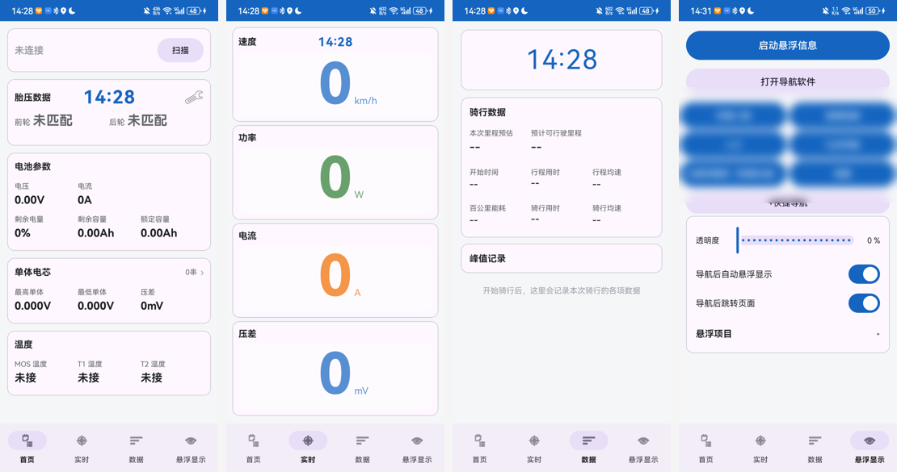
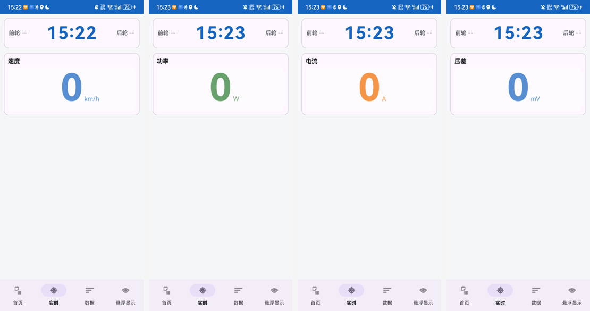
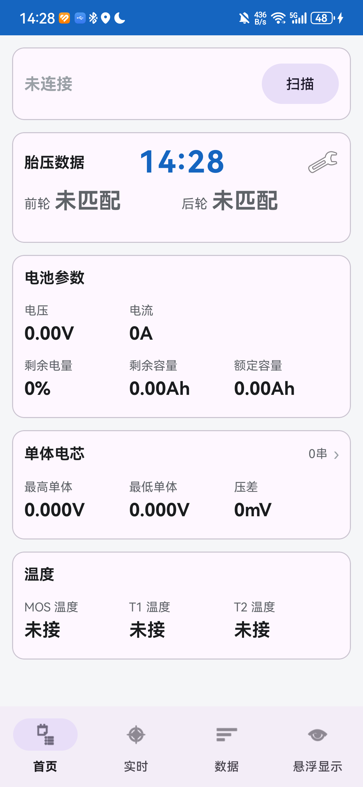
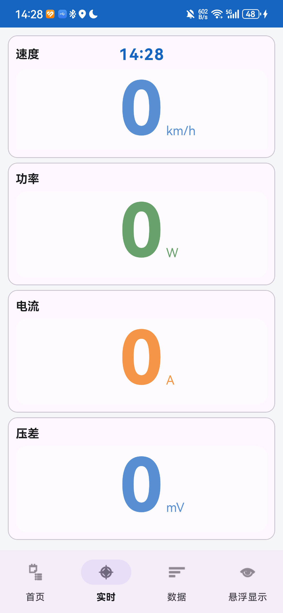
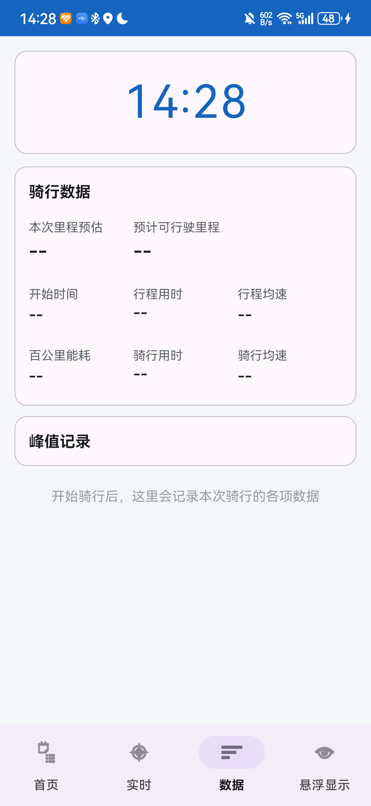
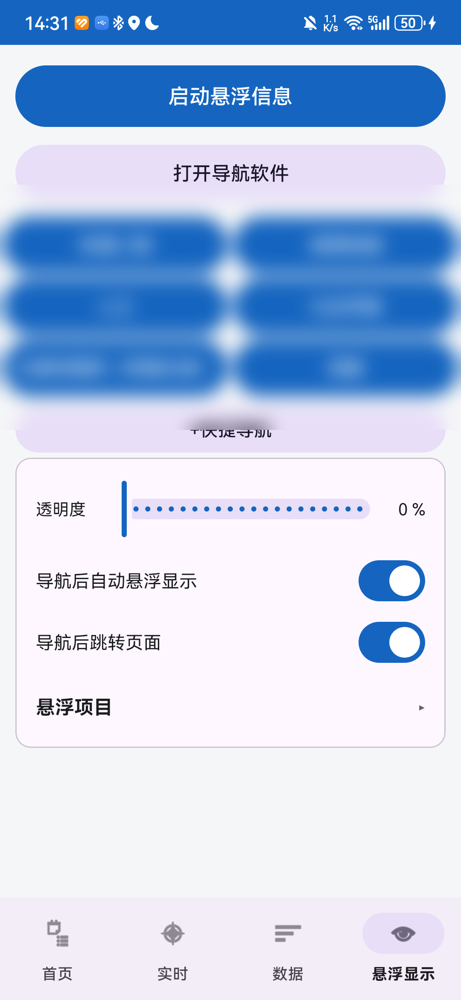
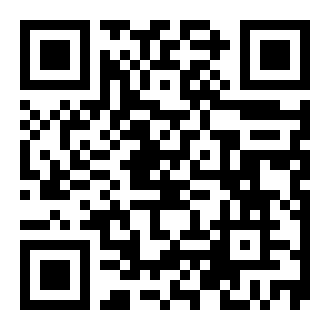

# RideAssist 骑行助手

原生 Android 应用（Kotlin + Jetpack），通过 BLE 蓝牙对接 BMS 电池保护板，并集成外置胎压监测（TPMS）。

> **纯只读工具**：只读取保护板数据，不下发任何参数写入或配置修改指令。
> 架构上不存在写保护板、均衡控制、密码验证等功能入口。
>
> **无本地持久化**：不引入 Room 与任何存储权限，应用无数据库、无文件写入。
>
> **很遗憾，我手上只有彦阳的保护板**，所以目前只适配了这一个品牌——
> 其他品牌协议各不相同，暂时无法支持（详见下方[兼容性](#兼容性)）。
>
> **欢迎大家二次开发，或者提供其他品牌的适配思路！**

## 页面与功能

APP 底部四个标签页：

### 🏠 首页 —— 设备连接与 BMS 总览

- **连接状态卡**：未连接保护板 / 连接中 / 已连接；首次进入自动重连上次设备，失败后可点「扫描」选择设备
- **电池状态卡**：总压 / 电流 / SOC / 剩余容量 / MOS 温度
- **单体电芯列表**：全部串的电压、最大压差、温度探头读数
- **告警区**：实测值 vs 阈值 并排展示（充电过压 / 欠压 / 过流 / 过温等）

### 📊 实时 —— 骑行核心数据

- 四张卡片：速度 / 功率 / 电流 / 单体压差，GPS 速度曲线可展开
- **卡片聚焦**：单击任意卡片只显示该卡 + 顶部时间卡；聚焦速度卡时，时间卡左右两侧直接显示前 / 后轮胎压；聚焦态左右滑快速切换卡片，双击显示 / 隐藏曲线
- **峰值记录卡**：聚焦的卡片收到数值后，下方会额外显示该指标的**本次会话峰值记录**——
  - 聚焦速度卡 → 「最大速度 xx km/h @ 时间」
  - 聚焦功率卡 → 「最大功率 xx W @ 时间」
  - 聚焦电流卡 → 「最大电流 xx A @ 时间」
  - 聚焦压差卡 → 内容最丰富：最大压差之外，还列出**当时的**工作电流、最高单体电压（单体号+电压）、最低单体电压，以及偏离最多的单体（偏高 / 偏低多少 mV）——压差异常时一眼定位是哪颗电芯
- **分屏配合**：聚焦模式是为**支持分屏的手机**设计的——启动导航后进入聚焦模式，
  屏幕一半是聚焦卡片、一半是导航地图，同时悬浮信息窗叠加在上方，
  骑行中一屏看全速度 / 胎压 / 导航
- **会话统计**：GPS 采样的速度曲线、最高速度、里程与能耗（含派生量不变性断言，防统计口径漂移）

### 📈 数据 —— 骑行记录

- 历史会话记录与汇总（最高速度 / 里程 / 能耗 / 记录详情）

### 🪟 悬浮显示 —— 悬浮窗与快捷导航

- **悬浮信息窗**：前台服务常驻，展示项目自选（拖动排序、双列布局）、字号 / 透明度可调
- **联动开关**（均可关闭）：导航后自动开启悬浮显示、自动跳转实时页并聚焦速度卡
- **快捷导航**：一键调起高德地图，输入框智能识别三类内容——
  - 含 `//` → 自定义链接，直接打开
  - `经度,纬度` 坐标 → 点击弹出「直接导航 / 路径规划」二选一
  - 地名 → 搜索并规划路径
- 按钮名称与目的地分离（可给同一目的地起别名）；**长按 600ms 进入编辑**，按住拖动排序

> **导航模块说明**：除「链接模式」外（自定义链接可调起任意应用），
> 其余模式（地名搜索 / 坐标导航与规划）**仅支持高德地图**。
> 经纬度可在高德[坐标拾取器](https://lbs.amap.com/tools/picker)获取。

## 🎬 演示视频

[docs/RideAssist-intro.mp4](docs/RideAssist-intro.mp4) —— 一分钟语音讲解：连接保护板 / 悬浮窗与快捷导航 / 开源说明（含隐私处理：设备名与自定义地点已模糊）

## 界面预览



**四种卡片聚焦模式**（速度 / 功率 / 电流 / 压差，聚焦速度卡时顶部时间卡两侧显示前 / 后轮胎压）。
有数值后聚焦卡下方会额外显示**峰值记录卡**（压差卡的记录最详细，含当时的工作电流与最高 / 最低 / 偏离最多的单体电芯）：



> 💡 聚焦模式配合**支持分屏的手机**使用效果最佳：启动导航后进入聚焦模式，
> 一半屏幕卡片 + 一半导航地图，悬浮信息窗同时叠加显示。

<details>
<summary>单页大图</summary>

| 首页 | 实时 | 数据 | 悬浮显示 |
|---|---|---|---|
|  |  |  |  |

</details>

## 下载

最新 Debug 构建（免安装包名 `.debug` 后缀）：

- [apk/RideAssist-v1.0.0-debug.apk](apk/RideAssist-v1.0.0-debug.apk)

> Debug 构建仅用于体验与测试，日常使用建议自行编译 Release 版。

## 构建

```
1. 用 Android Studio 打开本目录（wrapper 已指向 Gradle 8.13，JBR 21 可直接用）
2. 等待 Gradle 同步完成（已配置阿里云镜像，国内下载快）
3. 连接真机运行（BLE 功能必须在真机验证，模拟器不支持）
```

命令行构建：

```
./gradlew assembleDebug
```

最低 Android 版本见 `app/build.gradle.kts` 的 `minSdk`。

## 胎压监测详解

### 传感器绑定（首页胎压卡）

1. **长按胎压卡的某个轮位**（前轮 / 后轮）→ 弹出操作菜单
2. 选择「绑定」→ 进入倒计时窗口
3. 窗口内收到对应轮位的传感器广播即自动完成绑定（存下传感器 SN）
4. 倒计时内没等到广播 → 绑定失败自动复位

> ⚠️ 绑定规则是「窗口内出现的第一个未绑定传感器」——如果前后两颗传感器
> 都未绑定，请先装上其中一颗，绑完再装另一颗，避免绑错位置。

- **解绑**：长按已绑定的轮位 → 「解绑」，清空该轮位
- **前后对调**：前后轮都已绑定时，长按弹窗会出现「前后对调」，
  一键交换两颗传感器的轮位（拆车轮换位置后不用重新绑定）

### 报警阈值（首页右上角菜单 → 设置）

三项阈值均可点击修改，超出即红色告警：

| 阈值 | 说明 |
|---|---|
| 低压阈值 | 胎压低于此值标红 |
| 高压阈值 | 胎压高于此值标红 |
| 高温阈值 | 传感器温度高于此值标红 |

### 传感器购买

作者使用的是拼多多这款（广播式，可直接绑定使用）：

- 购买链接：<https://p.pinduoduo.com/fAJkfaIF?sc=EFAC>
- 扫码直达：

  

> ⚠️ 其他品牌 / 款式的 TPMS **不保证兼容**——广播数据格式各厂商不同，
> 买之前请确认是同类「摩托车icast/广播式传感器」。

### 传感器电池型号

设置页可保存传感器使用的**纽扣电池型号**（默认 CR1632）——
换电池的时候不用拆开传感器看是哪种型号。

### 数据来源

- 传感器以广播方式持续发包（胎压 / 温度 / 电量 / SN），**无需 GATT 连接**，装上即收
- 前后轮按传感器 SN 区分，与 BMS 的 BLE 连接互不干扰（占空比扫描错峰）

## 兼容性

- **目前仅兼容「彦阳 BMS」系列保护板**（BLE 协议为该系列定制，尚未适配其他品牌）
- 其他品牌保护板需按各自协议实现解析层（`core/protocol/`），欢迎 PR

## 使用前提

- 手机需授予「显示悬浮窗」权限（悬浮信息功能）
- BMS 保护板需开启蓝牙并处于可连接状态
- 胎压功能需外置 TPMS 传感器（广播式）——作者在用的[这款](https://p.pinduoduo.com/fAJkfaIF?sc=EFAC)即可

## 免责声明

- 本项目为社区开发的**第三方只读工具**，与任何保护板厂商无关
- BLE 协议参数来自社区对设备的观察与测试，仅供学习交流
- 数据仅供参考，**不作为电池安全判断依据**；电池安全请以专业设备与厂商为准
- 使用本项目产生的任何风险由使用者自行承担

## License

本项目以 [GNU AGPL-3.0](LICENSE) 协议开源——任何基于本项目的修改（包括网络服务形式提供）都必须同样以 AGPL-3.0 开源。
